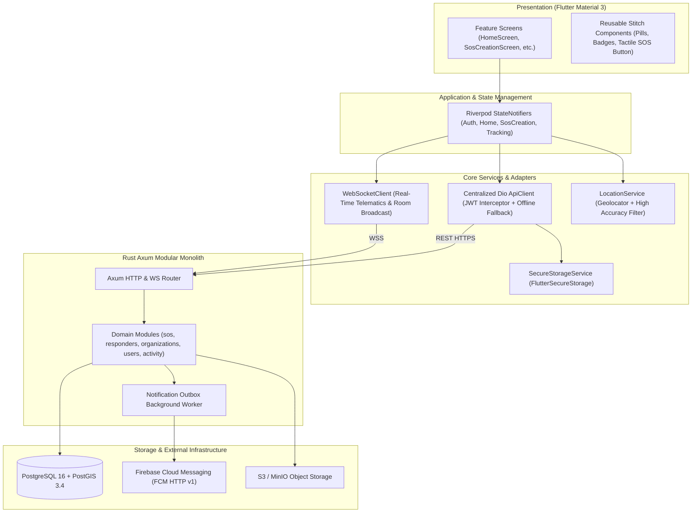

# PASHUPATI — Architectural Specification

## 1. Architectural Philosophy

Pashupati is engineered for high real-world reliability, sub-30-second emergency dispatch, and resilient edge execution under flaky cellular coverage in India.

The codebase strictly adheres to:
- **Clean, Feature-First Architecture**: Features are organized by domain capability (`home`, `sos`, `tracking`, `explore`, `activity`, `profile`, `notifications`).
- **Unidirectional Reactive State Flow**: Powered by Flutter Riverpod `StateNotifier` and immutable data classes.
- **Strict Separation of Concerns**: Presentation widgets never make direct network calls or execute business rules. All operations route through domain repositories and centralized clients.
- **Fail-Safe Geospatial Execution**: Geospatial filtering is performed natively in the database engine via PostGIS indexed queries rather than in-memory client filtering.

---

## 2. Layered Component Architecture



---

## 3. Frontend Architecture

### 3.1 Design System & Stitch Parity
- **Color Tokens**:
  - Forest Green: `#244D38` / `#0A3623` (Brand primary, trust badges, main CTAs)
  - Soft Green: `#E9F1E9` (Surface containers, active selection indicators)
  - Warm Ivory: `#FDF9EF` / `#F5F1E7` (Non-glare outdoor daytime canvas)
  - Saffron: `#D99A45` / `#E5A952` (Transit chips, community milestones)
  - Emergency Coral: `#C85C4A` / `#BA1A1A` (Strictly reserved for active SOS triggers & priority triage)
  - Secondary Text: `#747B73`
- **Typography**:
  - Headlines: Epilogue (bold geometric weight for counters and urgency headers)
  - Body & Labels: Plus Jakarta Sans (high legibility for forms, geolocation tags, and telemetry)
- **Shape & Elevation**:
  - Interactive elements: 16px radius
  - Cards: 24px radius
  - Badges & triggers: 9999px pill radius

### 3.2 State Management (Riverpod)
- All shared states are managed via `StateNotifierProvider` instances.
- State mutation is immutable via `copyWith`.
- Network state incorporates `isLoading`, `errorMessage`, and data payloads.

### 3.3 Offline & Network Resilience
- **Draft Persistence**: If network connectivity drops while filing an SOS, the draft is cached locally with GPS timestamp.
- **Transparent Mock Fallback**: The Dio client detects unreachable backends and seamlessly services requests using verified local seed data.

---

## 4. Backend Architecture (Rust Axum Monolith)

### 4.1 Modularity
The backend avoids microservices overhead in favor of a clean modular monolith:
1. `auth`: Phone OTP generation, validation, dev-mode bypass, and JWT issuing.
2. `sos`: SOS creation, duplicate detection, and finite state machine transitions.
3. `responders`: Primary and supporting responder acceptance, concurrency row locking, and ETA tracking.
4. `organizations`: Directory of verified 24/7 animal trauma centers and NGO shelters.
5. `geospatial`: PostGIS distance calculation, geospatial indexing, and spatial telemetry.
6. `notifications`: Outbox worker polling for pending push notifications.
7. `websocket`: Duplex connection hub managing SOS room subscriptions.

### 4.2 Concurrency Control & Race Condition Prevention
When two responders attempt to accept the primary response role simultaneously:
```sql
SELECT id, reporter_id, status, primary_responder_id 
FROM sos_requests 
WHERE id = $1 
FOR UPDATE;
```
The first responder acquires an exclusive row-level lock. If `primary_responder_id` is already assigned, subsequent responders are safely registered as `SUPPORTING` responders, preventing split-brain dispatches.

### 4.3 SOS Lifecycle State Machine
```text
           ┌───────────┐
           │   OPEN    ├──────────────┐
           └─────┬─────┘              │
                 │ Accept             │ Cancel / Expire
                 ▼                    ▼
           ┌───────────┐        ┌───────────┐
     ┌────►│RESPONDING │        │ CANCELLED │
     │     └─────┬─────┘        └───────────┘
     │           │ Arrive             ▲
Withdraw         ▼                    │
     │     ┌─────────────┐            │
     └─────┤HELP_ARRIVING├────────────┘
           └─────┬───────┘
                 │ Treat / Transport
                 ▼
     ┌───────────────────────┐
     │  ASSISTANCE_PROVIDED  │
     └───────────┬───────────┘
                 │ Resolve
                 ▼
           ┌───────────┐
           │ RESOLVED  │
           └───────────┘
```
Transitions are strictly validated in `backend/src/modules/sos/state_machine.rs` and recorded in `sos_status_history` for full audibility.

