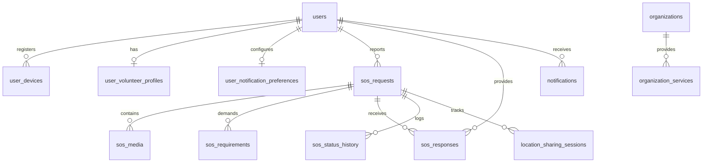

# PASHUPATI — Database Schema & PostGIS Design

## 1. Relational Database Overview

Pashupati uses **PostgreSQL 16** with the **PostGIS 3.4** extension for native geospatial spatial data processing.

All coordinates are stored in spatial columns with the type `geography(Point, 4326)` (WGS 84 coordinate reference system). Spatial indexes using GiST (Generalized Search Tree) are built on all location columns to ensure sub-millisecond proximity queries.

---

## 2. Entity Relationship Diagram



---

## 3. Table Dictionary

### 3.1 `users`
| Column | Type | Constraints | Description |
| :--- | :--- | :--- | :--- |
| `id` | UUID | PRIMARY KEY, DEFAULT uuid_generate_v4() | Unique user identifier |
| `phone` | VARCHAR(20) | UNIQUE, NOT NULL | Primary mobile number |
| `name` | VARCHAR(100) | NOT NULL | Full name / Callsign |
| `avatar_url` | TEXT | NULL | Profile image URL |
| `role` | VARCHAR(32) | NOT NULL DEFAULT 'REPORTER' | `REPORTER`, `VOLUNTEER`, `VET`, `ADMIN` |
| `preferred_language`| VARCHAR(10) | NOT NULL DEFAULT 'en' | ISO 639-1 language code |
| `created_at` | TIMESTAMPTZ | NOT NULL DEFAULT NOW() | Account creation timestamp |
| `updated_at` | TIMESTAMPTZ | NOT NULL DEFAULT NOW() | Last update timestamp |

### 3.2 `user_volunteer_profiles`
| Column | Type | Constraints | Description |
| :--- | :--- | :--- | :--- |
| `user_id` | UUID | PRIMARY KEY, FK -> users(id) | Associated user |
| `is_available` | BOOLEAN | NOT NULL DEFAULT TRUE | Duty status toggle |
| `verification_status`| VARCHAR(32) | NOT NULL DEFAULT 'UNVERIFIED' | `UNVERIFIED`, `PENDING`, `VERIFIED` |
| `vehicle_type` | VARCHAR(32) | DEFAULT 'NONE' | `TWO_WHEELER`, `FOUR_WHEELER`, `AMBULANCE` |
| `capabilities` | TEXT[] | NOT NULL DEFAULT '{}' | `FIRST_AID`, `TRANSPORT`, `VET_CARE` |
| `response_radius_km`| INTEGER | NOT NULL DEFAULT 5 | Configurable dispatch radius |
| `last_known_location`| geography(Point, 4326) | GIST INDEX | Live responder telemetry point |
| `rescues_completed_count`| INTEGER | NOT NULL DEFAULT 0 | Historical rescue tally |
| `badge_label` | VARCHAR(100) | NULL | Civic achievement badge |

### 3.3 `sos_requests`
| Column | Type | Constraints | Description |
| :--- | :--- | :--- | :--- |
| `id` | UUID | PRIMARY KEY, DEFAULT uuid_generate_v4() | SOS UUID |
| `case_number` | VARCHAR(32) | UNIQUE, NOT NULL | Human-readable tag (e.g. `SOS-BLR-8921`) |
| `reporter_id` | UUID | NOT NULL, FK -> users(id) | Citizen reporter |
| `status` | VARCHAR(32) | NOT NULL DEFAULT 'OPEN' | `OPEN`, `RESPONDING`, `HELP_ARRIVING`, `RESOLVED`, `CANCELLED` |
| `animal_type` | VARCHAR(32) | NOT NULL | `DOG`, `CAT`, `CATTLE`, `BIRD`, `OTHER` |
| `emergency_type`| VARCHAR(32) | NOT NULL | `INJURED`, `ROAD_ACCIDENT`, `TRAPPED`, etc. |
| `location` | geography(Point, 4326) | NOT NULL, GIST INDEX | Pinpoint incident coordinates |
| `accuracy_meters`| REAL | NULL | GPS accuracy circle in meters |
| `address` | TEXT | NOT NULL | Reverse-geocoded road address |
| `landmark` | TEXT | NULL | Landmark or field clues |
| `description` | TEXT | NULL | Situation remarks |
| `primary_responder_id` | UUID | NULL, FK -> users(id) | Claimed primary responder |
| `expires_at` | TIMESTAMPTZ | NOT NULL | Stale expiration cutoff |
| `created_at` | TIMESTAMPTZ | NOT NULL DEFAULT NOW() | Report filed timestamp |
| `updated_at` | TIMESTAMPTZ | NOT NULL DEFAULT NOW() | Last update timestamp |

### 3.4 `sos_responses`
| Column | Type | Constraints | Description |
| :--- | :--- | :--- | :--- |
| `id` | UUID | PRIMARY KEY, DEFAULT uuid_generate_v4() | Response ID |
| `sos_id` | UUID | NOT NULL, FK -> sos_requests(id) | Target incident |
| `responder_id` | UUID | NOT NULL, FK -> users(id) | Responder user |
| `response_role` | VARCHAR(20) | NOT NULL DEFAULT 'PRIMARY' | `PRIMARY`, `SUPPORTING` |
| `status` | VARCHAR(32) | NOT NULL DEFAULT 'EN_ROUTE' | `EN_ROUTE`, `ON_SITE`, `WITHDRAWN`, `COMPLETED` |
| `eta_minutes` | INTEGER | NULL | Estimated arrival time |
| `equipment_notes`| TEXT | NULL | Equipment loadout notes |
| `created_at` | TIMESTAMPTZ | NOT NULL DEFAULT NOW() | Acceptance timestamp |

### 3.5 `organizations`
| Column | Type | Constraints | Description |
| :--- | :--- | :--- | :--- |
| `id` | UUID | PRIMARY KEY, DEFAULT uuid_generate_v4() | Organization UUID |
| `name` | VARCHAR(255) | NOT NULL | Facility name |
| `org_type` | VARCHAR(32) | NOT NULL | `VET_HOSPITAL`, `NGO`, `SHELTER` |
| `description` | TEXT | NULL | Facilities & capabilities summary |
| `address` | TEXT | NOT NULL | Street address |
| `location` | geography(Point, 4326) | NOT NULL, GIST INDEX | Coordinates |
| `phone` | VARCHAR(32) | NOT NULL | Contact number |
| `emergency_phone`| VARCHAR(32) | NULL | 24/7 Hotline |
| `is_24_7` | BOOLEAN | NOT NULL DEFAULT FALSE | Round-the-clock emergency status |
| `is_verified` | BOOLEAN | NOT NULL DEFAULT FALSE | Verification mark |
| `facilities` | TEXT[] | NOT NULL DEFAULT '{}' | `AMBULANCE`, `ICU`, `SURGERY`, `OPD` |

---

## 4. Key Geospatial SQL Queries

### 4.1 Proximity SOS Discovery (Responders within radius)
```sql
SELECT 
    s.id, s.case_number, s.status, s.animal_type, s.emergency_type,
    ST_Y(s.location::geometry) as latitude,
    ST_X(s.location::geometry) as longitude,
    ST_Distance(s.location, ST_SetSRID(ST_MakePoint($1, $2), 4326)) as distance_meters,
    s.address, s.created_at
FROM sos_requests s
WHERE 
    s.status IN ('OPEN', 'RESPONDING', 'HELP_ARRIVING')
    AND ST_DWithin(s.location, ST_SetSRID(ST_MakePoint($1, $2), 4326), $3)
ORDER BY distance_meters ASC
LIMIT 50;
```

### 4.2 Potential Duplicate SOS Detector
```sql
SELECT s.id, s.case_number, s.status, s.description
FROM sos_requests s
WHERE 
    s.status IN ('OPEN', 'RESPONDING')
    AND ST_DWithin(s.location, ST_SetSRID(ST_MakePoint($1, $2), 4326), 500)
    AND s.animal_type = $3
    AND s.created_at >= NOW() - INTERVAL '2 hours';
```

